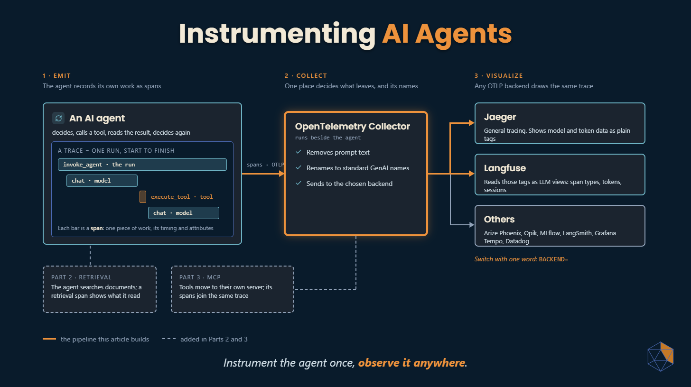
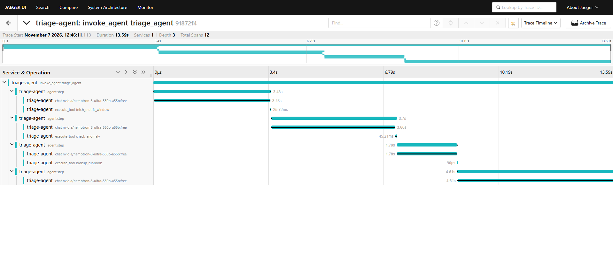
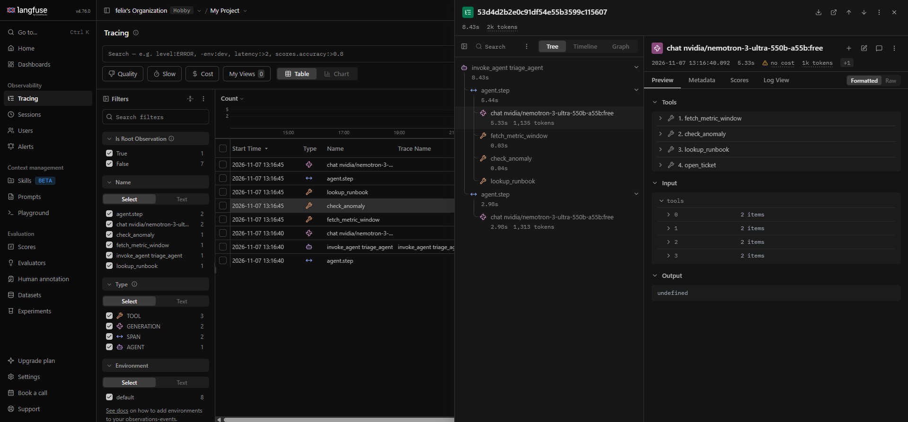

# Instrumenting AI Agents



Companion code for **Part 1** of the *AI System Design* series: how to see what an AI agent actually did, using OpenTelemetry.

The agent does a small version of an on-call job: it looks at a monitoring alert and decides whether it is real. It works over real AWS CloudWatch data from the [Numenta Anomaly Benchmark](https://github.com/numenta/NAB) and has four tools: fetch a metric window, check it for anomalies, look up a runbook, and open a ticket. It is not a production SRE agent; it is small enough to read in one sitting, and its job is to give the instrumentation something real to observe.

One of its three alerts goes wrong. The rest of this README is how you find out why.

## What you need

- Python 3.11+ and [uv](https://docs.astral.sh/uv/)
- Docker
- A free [OpenRouter](https://openrouter.ai) API key (no local model needed)
- For step 3 only: a free [Langfuse Cloud](https://cloud.langfuse.com) account

The OpenRouter free tier allows 50 model requests a day. One incident costs about 3–5 requests and replays cost none, so a free key covers everything below.

## Setup

```bash
cp .env.example .env      # add your OpenRouter key
make setup                # install dependencies
make seed                 # download three NAB series into data/series/
```

Free models come and go. To check the default `MODEL` in `.env` still exists and supports tool calling, list the ones that do:

```bash
curl -s https://openrouter.ai/api/v1/models | python3 -c "import sys,json; [print(m['id']) for m in json.load(sys.stdin)['data'] if m['id'].endswith(':free') and 'tools' in m.get('supported_parameters',[])]"
```

## 1. The black box

```bash
make run
```

Three alerts, three one-line decisions. `inc-101` opens a ticket for a real CPU spike. `inc-102` closes a quiet database alert as a false alarm. `inc-103` closes a network alert as a false alarm too. Is that right? The output can't tell you.

## 2. Turn tracing on

```bash
make up                         # Collector + Jaeger
make run INCIDENT=inc-103 TRACING=on
```

Open Jaeger at http://localhost:16686, pick the `triage-agent` service and open the trace. One run is one tree: the agent run, each step, the model call that made each decision, and the tool it asked for.



Click `execute_tool fetch_metric_window` and open its Tags. `tool.args.start` says the agent asked for **25 April**. `tool.data.start` says the data the tool actually used was from **23–24 April**. The network series ends on 24 April; instead of saying so, the tool quietly fell back to the latest data it had, without telling the agent. The model judged the alert on the wrong day, and only the trace shows it.

Your run may take a different number of steps: the model picks its path each time. That is the point of tracing a run rather than a request.

## 3. Same trace, different tool

The agent only talks to the Collector, so the backend is a config change. Create a project in Langfuse Cloud, copy its keys into `.env`, and set the endpoint for your project's region (EU `https://cloud.langfuse.com/api/public/otel`, US `https://us.cloud.langfuse.com/api/public/otel`). Then:

```bash
make down
make up BACKEND=langfuse
make run INCIDENT=inc-103 TRACING=on
```



Same tree, plus LLM views: span types, token counts, sessions. Output is empty because the Collector removes prompt and completion text before anything leaves your machine (`collector/base.yaml`). The tool definitions the model was offered are kept on purpose. "No cost" appears because cost is a pricing table applied by the backend, and a free model has no price.

If nothing arrives, `docker compose logs collector` shows export errors; a `401` means the keys or the region are wrong.

## 4. Replay and fix

Every run is recorded to `runs/`. Replaying reruns the tools but reuses the model's recorded answers, so it costs no model requests:

```bash
make replay RUN=<run id from step 2>
```

Now apply the fix (the tool reports missing data instead of falling back) and replay again. When a tool result changes, replay switches to the live model from that point:

```bash
make replay RUN=<same run id> TOOL_FIX=1
make diff A=<original run id> B=<new run id>
```

The diff points at the first thing that changed: the `fetch_metric_window` result, numbers from the wrong day in the original and "no data" in the fix. The agent's answer becomes "cannot verify", which is the right call for an alert you have no data for.

## Layout

```text
agent/        the loop, the model client and the four tools
telemetry/    tracing setup and the spans added by hand
replay/       record, replay and diff
collector/    Collector config: one shared file plus one per backend
data/         NAB download script
assets/       cover and screenshots used here and in the article
incidents.yaml
```

## Notes

- **The GenAI conventions are not stable yet.** OpenTelemetry's GenAI semantic conventions are still in development status, so attribute names can change. Instrumentation versions are pinned in `pyproject.toml`; the Collector's rename step absorbs drift between libraries.
- **Free models change.** If the model in `.env.example` disappears from OpenRouter, pick another free model that supports tool calling. Results vary between models and between runs; the trace is how you see the difference.
- **Prompt data.** Some free providers may use prompts for training. Everything this agent sends is public benchmark data.
- **Ports** are bound to localhost only.
- NAB data © Numenta, used under its licence. Code in this repo is MIT.

**Next:** Part 2 gives the agent a searchable set of runbooks, and the trace starts showing what it read, not just what it called. Part 3 moves the tools behind an MCP server, and one trace follows them across the process boundary.
